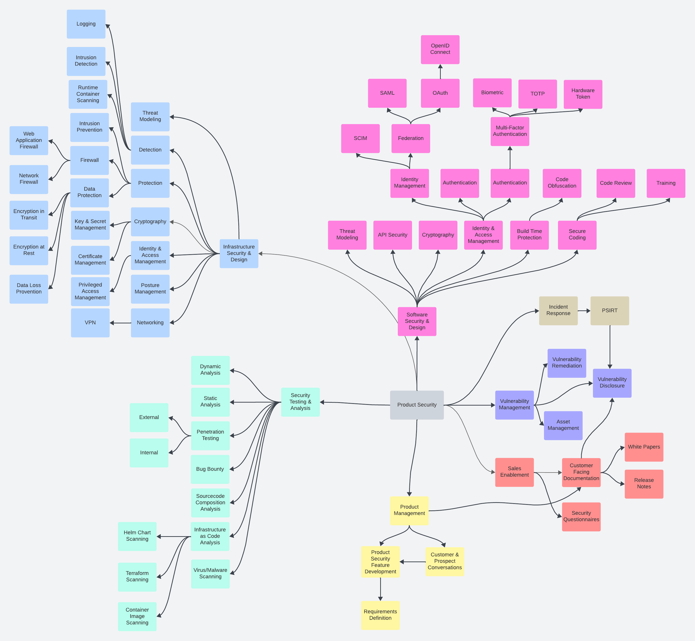

+++
date = '2023-11-28'
draft = false
title = 'Application Security and Product Security are NOT the same'
description = "The security field is constantly evolving. While Application Security has been around since the early 2000s, Product Security has only gained popularity in the last 5-8 years. Is Product Security just a rebrand of AppSec? There's no universal agreement on what it actually is."
categories = ['Security']
tags = ['application-security', 'Product Security', 'appsec', 'Career']
image = 'header.png'
[params]
  author = 'Matt Goodrich'
+++

The security field, just like many other fields is constantly evolving. Application Security is nothing new, we have been talking about it since (arguably) the 1970's, though "modern" AppSec really started to evolve in the early 2000's. Product Security however has only started increasing in popularity in the last 5-8 years.

Is Product Security just a fresh brand on Application Security? Some certainly think so. One thing is for certain, there is no agreement on what it actually is.

<!--more-->

Every Product Security team looks different, and requires different domain knowledge. If you are on a team that has to support on-premises software and cloud based software you need to know a heck of a lot. In the cloud, you get a lot for free, and it's easy to take that for granted when you have to then think about the same patterns on-premises where you have very few guarantees of capabilities existing, or following the same patterns they do in cloud.

The mind map below represents my quick take on the domains and subdomains that have been most common with the products and teams I have worked on.

Among the items listed above, the high level categories are:

* Infrastructure Security and Design
* Software Security and Design
* Vulnerability Management
* Security Testing and Analysis
* Sales Enablement
* Product Management

The video below covers all of this at a high level, but we will be diving deep into each of these areas in future posts and videos.


