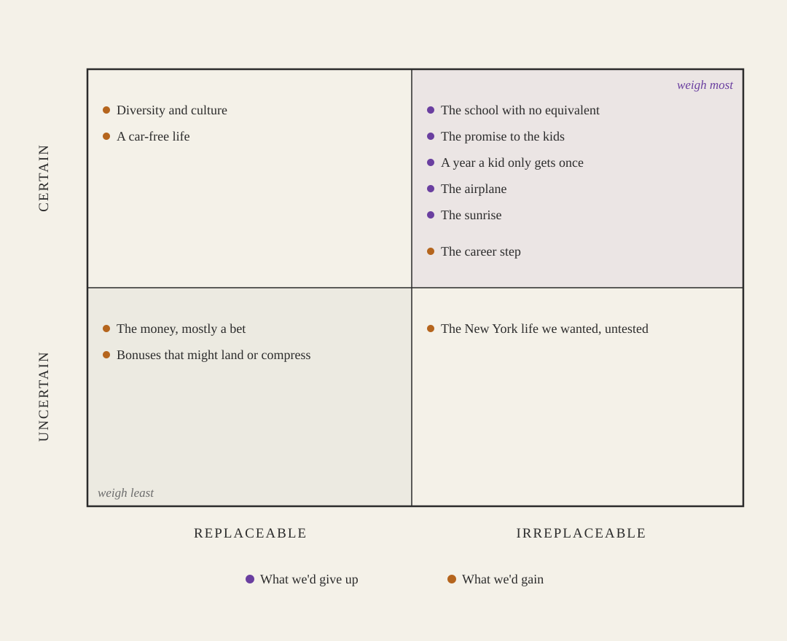

+++
date = '2026-09-21T00:01:00-07:00'
draft = true
title = 'Saying No to Something You Want'
aliases = []
description = "Earlier this year I turned down a role I'd wanted my whole career. The offer fit in a spreadsheet: the comp, the title, the prestige. What we'd have given up to take it, the school, the airplane, the house we love, didn't fit anywhere, and that asymmetry is what made the decision hard and, in the end, clear."
categories = ['Career Development', 'Personal Growth']
tags = ['Career', 'Family', 'Decision Making', 'Leadership', 'Bainbridge Island']
image = 'header.png'
[params]
  author = 'Matt Goodrich'
+++

Earlier this year I got the offer I'd been working toward for as long as I've had a career. A role at a firm in New York that's one of the best in the world at what they do, the kind of name that keeps working for you on a resume ten years later. I'd wanted it, specifically it, for a long time. I said no.

I still think about it. Not with regret exactly. More the way you keep touching a decision to see if it's still warm.

The strange part is that the offer was the easy half to think about. What made the whole thing hard was everything that wouldn't fit on the same page as it.

## The Offer Fit in a Spreadsheet

Everything that made the job attractive was legible. The title. The comp. The prestige of the name. The people I'd work next to, a building full of engineers. The recruiter put the real pitch in one line: over the next five years, the scope and the rigor and the credibility of having succeeded somewhere like this could materially change what's available to me. I read that and thought, yes, that's exactly right. That's the thing I've felt myself missing.

All of it went into a spreadsheet, and the spreadsheet said go.

Then it surprised me. On base salary, after New York taxes and what it costs to live there, the money came out within about a thousand dollars a month of what we already have where we are. Nearly identical. The real upside lived in bonuses that might land big or might get compressed in a bad year. So even the most quantifiable thing, the money, was mostly a bet. The career part was not a bet. The career part was as close to certain as these things get, and it was the part I wanted most.

## The Things That Wouldn't Go In It

The reasons to stay didn't have cells.

We live on an island. I watch the sunrise from the house every morning, which sounds like a quality-of-life line until it's the actual first thing that happens in your actual day. We came to Washington for the climate in the first place, mild enough that the kids can play outside all year without freezing, with air clean enough that outside is where you'd want them. We bought this house in January, and we told the kids we'd be here a long time. That was a specific promise to specific people, made partly to end a pattern of moving.

Both kids are in a public school that's genuinely rare, a multiage program that's one of the best in the state, and it's free. My oldest, about to start third grade, talks about what they're looking forward to there next year. My youngest was about to start kindergarten in the same school.

We have grandparents close by, and the kids see them all the time. That regular presence is a real gift, the kind that knows what the kids had for breakfast and which game they're into this week.

My wife writes. She was already an author before we came here, but the island is where she found her people. There's a place on Bainbridge called BARN, the Bainbridge Artisan Resource Network, a 25,000-square-foot makerspace with ten studios where woodworkers, metalsmiths, glass artists, printmakers, and writers all work under one roof. It's genuinely unusual, the kind of thing you don't expect to find on a small island. She found her writers there, at a roundtable that meets in person, in the same room, twice a month. That community is what moving here gave her.

She also, for the first time, has doctors here who seem interested in actually solving her problems. She'd never really had that before, never felt like anyone was listening or cared to dig in. Now she does.

And there's an airplane. I'll say this part plainly because it embarrasses me a little. I fly a 1977 Bonanza I've put years into. The ratings, the instrument proficiency, the slow accumulation of getting genuinely good at a hard thing, all of it lives in that airplane. Selling it sat on the spreadsheet as the responsible move, and it was the responsible move. Responsible and easy aren't the same word. You can't put "a chapter I'm not done with" in a cell.

None of that is quantifiable. All of it is real.

## Who the Move Was Actually For

The thing I kept circling was who this was for.

The move served my career most directly. Everyone else would absorb the cost of it. My wife would leave the community she'd built from nothing. The kids would leave the school, the grandparents, and the first house that's felt like theirs. The one clear beneficiary was me, and I'd be the one gone at the office four or five days a week while everyone else did the hard part of landing in a new city.

There were other irons in the fire too, ones that didn't require relocating at all. They moved the career needle less, but they asked the family to sacrifice nothing, and they sat on the table the whole time.

I wrote to my wife, in the middle of this, that I wasn't articulating myself well. The career logic was clear. The money logic mostly worked. The emotional logic would not resolve. What I was feeling was guilt, and I had to work out whether the guilt was information or just noise. Was it telling me the move was wrong, or was it the ordinary price of a hard decision that's still correct? Those are different things, and from the inside they feel identical.

## Sorting by Replaceable and Certain

Here's what finally made the decision possible. We changed the question. We stopped asking which life was better, because that question has no answer. Both lives are good, and they're good in a currency that doesn't convert.

We sorted every item, on both sides, along two axes. Is it replaceable? And is it certain?

Replaceable and uncertain is the cheap corner. If a thing can be rebuilt and might not even happen, it shouldn't drive a decision this size. Irreplaceable and certain is the expensive corner. If a thing is guaranteed to be lost and can't be rebuilt, it should carry the most weight.

When we ran everything through that, a pattern showed up that was hard to unsee. Almost everything we'd give up landed in the expensive corner. The school with no equivalent. The promise, which you can explain but can't un-break. A school year a kid only gets once. The airplane. The sunrise. Gone, and not comeback-able. The heaviest of those belonged to the kids, and they didn't choose any of it.

Almost everything we'd gain landed in the cheaper corners. The career step was the honest exception. It's genuinely irreplaceable and genuinely certain, and it belongs in the expensive corner too, which is exactly why it was so hard to turn down. But the money was a bet. The city life we'd always wanted was real as a desire and untested as an experience, especially with two kids mid-childhood, which is not the version we used to picture. The diversity and the culture were real gains for the kids, and also the rebuildable-over-time kind. The upside was mostly maybe.

So the sort came out lopsided. The losses were mostly certain and permanent. The gains were mostly conditional, except for the one that mattered most to me personally. That didn't make the decision. It made the decision visible.

## The Bias Built Into the Sort

I want to be careful here, because a framework that always tells you to protect what you already have is just a cautious personality doing math.

The sort has a bias in it, and I know which way it leans. What you already have is concrete, so it's easy to file as irreplaceable and certain. What you'd gain is in the future, so it's easy to file as uncertain and talk yourself out of. Run this honestly and staying wins almost every time, which should make you suspicious of it. "I chose my family" and "I chose the comfortable thing and called it choosing my family" produce the exact same spreadsheet.

The costs of staying are real too, and they're worse in one way: they're slow. A career ceiling doesn't announce itself. The opportunity that doesn't come back doesn't send a notice. If the situation I'm in now quietly deteriorates and the door I closed stays closed, I'll find that out in a few years, in slow motion, and I won't be able to point at the moment it cost me. Fast costs at least let you grieve them on a date. Slow costs just accumulate.

So I don't pretend the sort was objective. What kept it honest, for us, was a rule my wife set and I agreed to: full confidence, or we don't go. Not "on balance." Not "probably." Both of us all the way in, or the answer is no. That's a high bar on purpose. It's built to fail unless the case is overwhelming, and if a move this disruptive to the kids can't clear an overwhelming bar, it shouldn't happen on a coin flip. We didn't clear it. Not because the case was weak, but because full confidence is a lot to ask of two people, and we were honest that we didn't both have it.

## You Don't Get to Stop Wanting It

I turned it down in April. The people at the firm were gracious about it. Life on the island continued, which was the whole thing I'd been trying to protect. Some mornings that continuity feels like proof I was right. Some mornings it feels like the sound of a door I closed.

That's the part nobody warns you about with saying no to something you want. You don't get to stop wanting it. The decision doesn't arrive with relief that settles the question. It arrives with something quieter: you looked at what you'd have to spend, in the currency that doesn't convert, and you decided you weren't willing to spend it. I wasn't deciding the thing wasn't worth wanting. I still think it was worth wanting. I just wasn't willing to pay for it with the specific things it would have cost.

If you're ever in the middle of one of these, I'd offer only one thing. Get the unquantifiable items out of your head and onto the same page as the quantifiable ones, in as much specific detail as you can stand. Name the sunrise. Name the airplane. Give them enough weight that they can actually lose to a number, or beat it. The spreadsheet is honest about everything it can count. The problem is what it can't, and the gap always runs the same direction, toward the things that hold still long enough to be counted. The decision gets honest at the moment the things you can't count are allowed to win.
